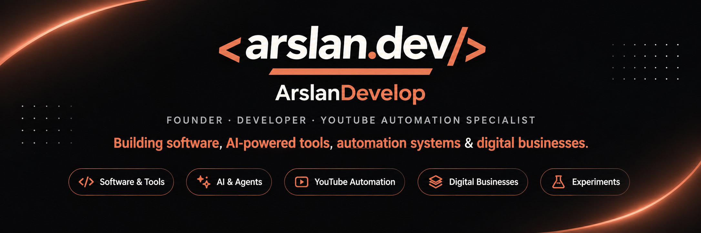

---

## About Me

I'm **Arslan** — a founder, software developer and YouTube Automation specialist.

I build companies, develop software, experiment with artificial intelligence and create tools that turn ideas into working products.

This GitHub is my central development hub, bringing together my businesses, software projects, automation systems and technical experiments.

My approach is simple: **Build. Automate. Improve.**

---

## What I Do

| Expertise | Focus |
|:---|:---|
| **Software Development** | Applications, platforms, APIs and developer tools |
| **AI & Agents** | AI-powered tools, intelligent agents and automated workflows |
| **YouTube Automation** | Content production systems, channel workflows and scalable automation |
| **Digital Businesses** | Building companies, digital products and online platforms |
| **Automation & Integrations** | Connecting systems, streamlining processes and improving efficiency |

---

## Projects & Companies

A central place for the businesses, products and software I'm developing.

| Category | Description |
|:---|:---|
| **Companies** | Businesses, brands and digital ventures |
| **Software & Tools** | Applications, utilities and custom-built solutions |
| **AI Projects** | AI agents, experiments and intelligent systems |
| **YouTube Automation** | Tools and infrastructure for content workflows |
| **Research & Experiments** | Prototypes, technical research and new ideas |

Projects and repositories will be linked here as they become publicly available.

> **Note:** Some projects are maintained privately to protect proprietary software, internal infrastructure and ongoing development.

---

## Current Focus

- Building and scaling digital businesses
- Developing software products and developer tools
- Creating AI-powered applications and intelligent agents
- Designing YouTube Automation systems and workflows
- Exploring new technologies and automation opportunities

---

## Development Philosophy

**Build with purpose. Automate what matters. Keep improving.**

I focus on creating practical solutions that solve real problems, reduce repetitive work and make digital systems more efficient.

From early experiments to production-ready software, every project is an opportunity to learn, build and improve.

---

## GitHub Activity

My public repositories, contributions and ongoing development work can be explored directly on my GitHub profile.

Private projects remain private, while selected tools, experiments and open-source work are shared publicly.

[**Explore my repositories →**](https://github.com/ArslanDevelop?tab=repositories)

---

### Build. Automate. Improve.

*From ideas to working systems.*

**ArslanDevelop**

[GitHub Profile](https://github.com/ArslanDevelop) · [Repositories](https://github.com/ArslanDevelop?tab=repositories)

Founder · Developer · YouTube Automation Specialist

